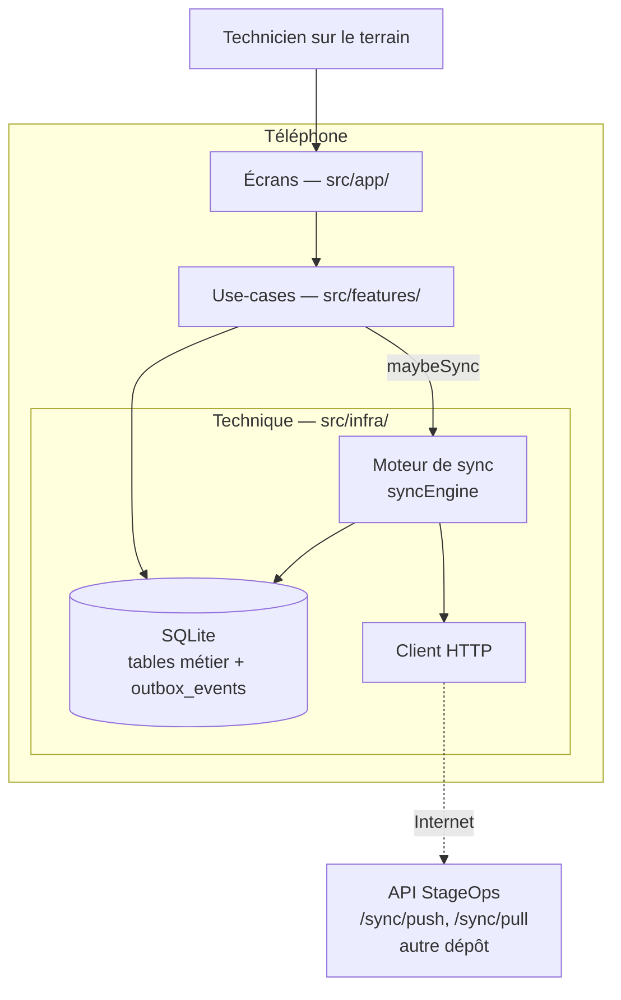
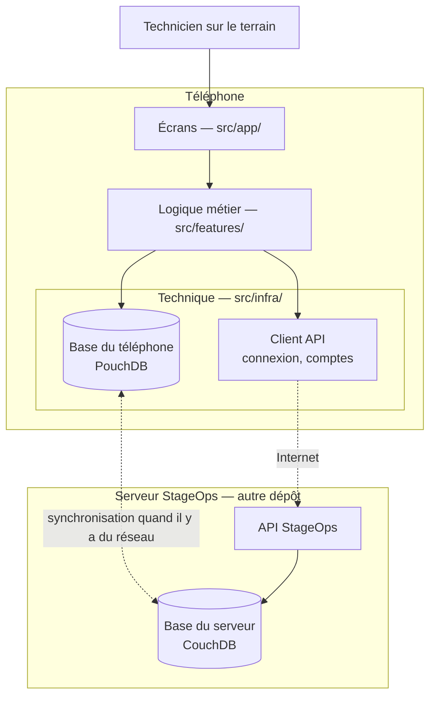
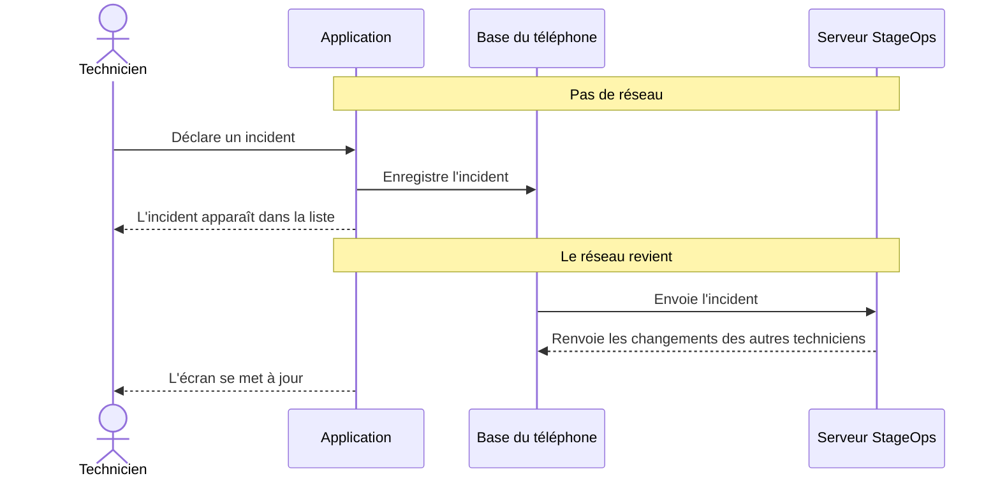

# Architecture — StageOps Mobile

StageOps Mobile est l'application terrain des techniciens de spectacle. Elle doit fonctionner
même sans réseau : en coulisses ou en salle, la connexion est souvent absente ou instable.

Ce document décrit l'organisation du code, puis deux architectures :

- l'**architecture actuelle** : le prototype du MVP, qui stocke ses données dans SQLite avec une
  file d'attente (outbox) ;
- l'**architecture cible** : PouchDB sur le téléphone, répliqué avec CouchDB côté serveur.

La décision et sa raison sont dans [`DECISIONS.md`](DECISIONS.md) ; le plan de migration est
décrit dans le wiki : [Migration PouchDB / CouchDB](https://github.com/StageOps-EIP/StageOps/wiki/Migration-PouchDB-CouchDB).
Le détail des données est dans [`SCHEMA.md`](SCHEMA.md).

Dans les deux cas, l'idée clé est la même : l'application lit et écrit **toujours** dans la base
du téléphone. Le réseau n'intervient qu'en arrière-plan, pour synchroniser.

## Organisation du code

Le code vit dans `apps/mobile/src/`, rangé en couches :

| Couche | Dossier | Rôle |
|---|---|---|
| Écrans | `src/app/` | Ce que le technicien voit et touche : les écrans et la navigation. |
| Logique métier | `src/features/` | Les règles de l'application, avec un dossier par domaine métier, chacun avec `usecases/` et `ui/`. |
| Technique | `src/infra/` | La base du téléphone, la synchronisation, les appels au serveur et les logs. |
| Commun | `src/shared/` | Les types, constantes et petits outils utilisés par toutes les couches. |

### Règle des couches

Chaque couche n'utilise que la couche juste en dessous : écrans → logique métier → technique.

- Un écran n'importe jamais les repositories, le moteur de sync ni le client HTTP (`@infra/db`,
  `@infra/sync`, `@infra/api`) : il passe par un use-case.
- Le logger (`@infra/logging`) est importable partout.
- `src/shared/` est importable par toutes les couches et n'importe rien d'autre.
- Seule exception autorisée : `src/app/AppProviders.tsx`, qui ouvre la base, applique les
  migrations et insère les données de démo au démarrage, avant d'afficher le premier écran.

Ainsi, les écrans restent simples et la logique peut être testée seule.

## Architecture actuelle (prototype SQLite)

### Ce que fait l'application

| Domaine (`src/features/`) | Ce que le technicien peut faire |
|---|---|
| `dashboard` | Voir les chiffres clés de l'inventaire et des incidents, et les derniers incidents. |
| `inventory` | Consulter l'inventaire, filtrer le matériel, voir la fiche d'un équipement et changer son état. |
| `incidents` | Déclarer un incident, éventuellement lié à un équipement. |
| `sync` | Voir l'état de la synchronisation, la file des modifications en attente, relancer un envoi en échec. |

### Vue d'ensemble

### Fonctionnement hors ligne

1. Chaque modification est enregistrée dans SQLite et un événement est ajouté à la table
   `outbox_events`. Elle apparaît immédiatement à l'écran, avec ou sans réseau.
2. Une synchronisation est demandée via `maybeSync()`, qui ne fait rien hors ligne ou si une
   synchronisation est déjà en cours. Le bouton manuel de l'écran de synchronisation appelle
   `syncNow()`.
3. Un cycle de synchronisation envoie les événements en attente (`/sync/push`), les marque
   envoyés ou en échec selon la réponse du serveur, récupère les changements du serveur depuis le
   dernier curseur (`/sync/pull`), les applique localement, puis enregistre le nouveau curseur.
4. En cas d'échec, un nouvel essai est programmé avec un délai croissant (backoff exponentiel).
5. Dans le prototype, la version dont l'`updated_at` est le plus récent l'emporte, sans fusion
   (last write wins).

Les tables SQLite sont décrites dans [`SCHEMA.md`](SCHEMA.md#base-actuelle-prototype-sqlite).

## Architecture cible (PouchDB / CouchDB)

### Ce que fera l'application

| Domaine | Ce que le technicien peut faire |
|---|---|
| Connexion | Se connecter, rester connecté, travailler hors ligne pendant une durée limitée. |
| Projets | Choisir le projet (spectacle, festival…) sur lequel il travaille. |
| Matériel | Consulter l'inventaire, voir et changer l'état d'un équipement, voir son adressage DMX. |
| Scan QR | Scanner le QR code d'un équipement pour ouvrir directement sa fiche. |
| Incidents | Déclarer un problème et suivre sa résolution (lumière et son uniquement). |
| Événements | Consulter les événements du théâtre. |
| Équipe | Consulter les membres de l'équipe. |

### Qui voit quoi

Les données sont organisées comme sur le serveur : un **théâtre** contient des **projets**, et
chaque projet active un ou plusieurs **modules** (lumière, son, plateau). Le matériel et les
incidents sont rangés par module.

- Le **régisseur général** voit tous les modules.
- Un **technicien** ne voit que les modules qui lui sont attribués.

C'est le serveur qui décide des droits ; l'application les applique.

### Vue d'ensemble

Les flèches en pointillés ne fonctionnent que lorsqu'il y a du réseau.

### Fonctionnement hors ligne

1. Chaque action est enregistrée tout de suite dans la base du téléphone. Elle apparaît
   immédiatement à l'écran, avec ou sans réseau.
2. Dès que le réseau revient, le téléphone et le serveur s'échangent leurs modifications, dans les
   deux sens.
3. Après la migration vers PouchDB, les conflits passeront par le mécanisme de révisions de
   CouchDB/PouchDB.
4. Le téléphone ne reçoit que les données de son théâtre et de ses projets. Les comptes et les
   sessions ne sont jamais copiés sur le téléphone.

### Trajet d'une action

Exemple : un technicien déclare un incident sans réseau, puis le réseau revient.

### Connexion et sécurité

- La première connexion se fait en ligne, avec un email et un mot de passe.
- L'application garde la session ouverte et la renouvelle toute seule. Les informations de session
  sont rangées dans le stockage sécurisé du téléphone.
- Pour le hors ligne, le serveur remet au téléphone une **autorisation valable 7 jours au
  maximum**. Le téléphone peut la vérifier seul, sans réseau. Passé ce délai, il faut se
  reconnecter.
- Si un compte ou un téléphone est révoqué, le téléphone ne l'apprend qu'à sa prochaine
  connexion au réseau.

## Hors périmètre

Voir la section « Hors périmètre pour l'instant » de [`CLAUDE.md`](../CLAUDE.md).
