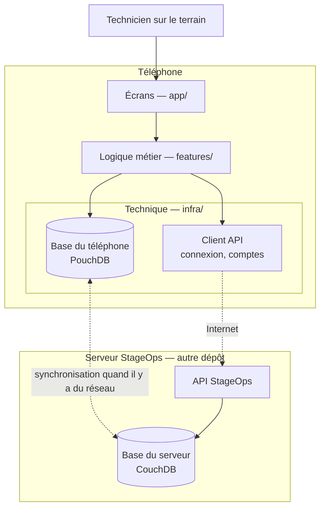
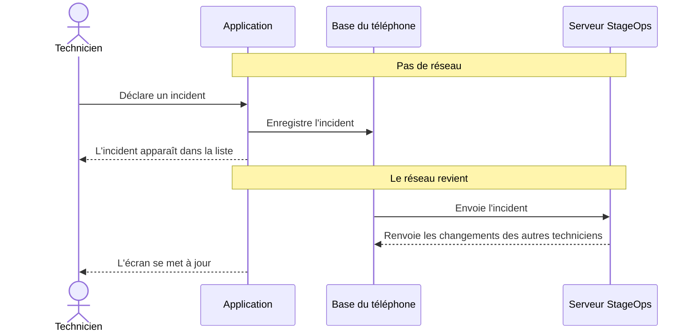

# Architecture — StageOps Mobile

StageOps Mobile est l'application terrain des techniciens lumière, son et plateau d'un théâtre.
Elle doit fonctionner même sans réseau : en coulisses ou en salle, la connexion est souvent
absente ou instable.

Ce document décrit l'architecture **visée**. Le code actuel est une première version (MVP) qui
va évoluer vers elle ; les écarts sont listés à la fin.

## En bref

- L'application enregistre tout **d'abord sur le téléphone**, puis se synchronise avec le serveur
  dès que le réseau est là.
- Le téléphone stocke ses données dans **PouchDB**, une base qui sait se synchroniser toute seule
  avec **CouchDB**, la base du serveur.
- La connexion et les comptes passent par l'**API StageOps** (le backend, dans un autre dépôt).
- Le code est rangé en trois couches : les écrans, la logique métier et la partie technique.

## Ce que fait l'application

| Domaine | Ce que le technicien peut faire |
|---|---|
| Connexion | Se connecter, rester connecté, travailler hors ligne pendant une durée limitée. |
| Projets | Choisir le projet (spectacle, festival…) sur lequel il travaille. |
| Matériel | Consulter l'inventaire, voir et changer l'état d'un équipement, voir son adressage DMX. |
| Scan QR | Scanner le QR code d'un équipement pour ouvrir directement sa fiche. |
| Incidents | Déclarer un problème et suivre sa résolution (lumière et son uniquement). |
| Événements | Consulter les événements du théâtre. |
| Équipe | Consulter les membres de l'équipe. |

**Hors périmètre pour l'instant** : les positions 3D du matériel et la scène en 2D (en suspens).

### Qui voit quoi

Les données sont organisées comme sur le serveur : un **théâtre** contient des **projets**, et
chaque projet active un ou plusieurs **modules** (lumière, son, plateau). Le matériel et les
incidents sont rangés par module.

- Le **régisseur général** voit tous les modules.
- Un **technicien** ne voit que les modules qui lui sont attribués.

C'est le serveur qui décide des droits ; l'application les applique.

## Vue d'ensemble

L'idée clé : l'application lit et écrit **toujours** dans la base du téléphone. Le réseau
n'intervient qu'en arrière-plan, pour synchroniser. C'est ce qui permet de travailler sans
connexion.

Les flèches en pointillés ne fonctionnent que lorsqu'il y a du réseau.

## Les couches

| Couche | Dossier | Rôle |
|---|---|---|
| Écrans | `app/` | Ce que le technicien voit et touche : les écrans et la navigation. |
| Logique métier | `features/` | Les règles de l'application (changer l'état d'un équipement, déclarer un incident…), avec un dossier par domaine. |
| Technique | `infra/` | La base du téléphone, la synchronisation, les appels au serveur et la session de connexion. |
| Commun | `shared/` | Les types, constantes et petits outils utilisés par toutes les couches. |

**Règle** : chaque couche n'utilise que la couche juste en dessous. Un écran ne parle jamais
directement à la base ou au serveur : il passe par la logique métier. Les écrans restent simples
et la logique peut être testée seule.

**Seule exception** : `AppProviders`, le composant qui prépare l'application au lancement. Il
doit ouvrir la base avant d'afficher le premier écran.

## Fonctionnement hors ligne

1. Chaque action est enregistrée tout de suite dans la base du téléphone. Elle apparaît
   immédiatement à l'écran, avec ou sans réseau.
2. Dès que le réseau revient, le téléphone et le serveur s'échangent leurs modifications, dans les
   deux sens.
3. Si deux personnes ont modifié la même chose hors ligne, CouchDB détecte le conflit et choisit
   une version gagnante. L'autre version est conservée, pour pouvoir être signalée.
4. Le téléphone ne reçoit que les données de son théâtre et de ses projets. Les comptes et les
   sessions ne sont jamais copiés sur le téléphone.

### Trajet d'une action

Exemple : un technicien déclare un incident sans réseau, puis le réseau revient.

## Connexion et sécurité

- La première connexion se fait en ligne, avec un email et un mot de passe.
- L'application garde la session ouverte et la renouvelle toute seule. Les informations de session
  sont rangées dans le stockage sécurisé du téléphone.
- Pour le hors ligne, le serveur remet au téléphone une **autorisation valable 7 jours au
  maximum**. Le téléphone peut la vérifier seul, sans réseau. Passé ce délai, il faut se
  reconnecter.
- Si un compte ou un téléphone est révoqué, le téléphone ne l'apprend qu'à sa prochaine
  connexion au réseau.

## Étape intermédiaire

La synchronisation entre PouchDB et CouchDB n'est pas encore disponible côté serveur : elle
dépend de l'équipe backend.

En attendant, l'application échange directement avec l'API StageOps quand le réseau est là. Le
fonctionnement hors ligne complet arrivera avec la synchronisation.

## Écarts avec le code actuel

Le code actuel est un MVP. Ce qui va changer pour atteindre l'architecture visée :

- **Stockage** : le téléphone utilise aujourd'hui SQLite avec une file d'attente faite maison. Il
  sera remplacé par PouchDB.
- **Données** : les projets et les modules n'existent pas encore, et les valeurs (états, gravités,
  catégories) ne sont pas alignées sur celles du serveur.
- **Fonctionnalités** : pas encore de connexion, de scan QR, d'événements ni d'équipe.
- **Règle des couches** : deux fichiers ne la respectent pas encore (l'écran de la file de
  synchronisation et le bandeau de synchronisation).
- **Expo Go** : il sert pour le MVP. L'application le quittera ensuite pour une version compilée
  par l'équipe.

## Points ouverts

- **Synchronisation côté serveur** : à suivre avec l'équipe backend.
- **Scène 2D** : en suspens.
- **Départ d'Expo Go** : prévu après le MVP.
