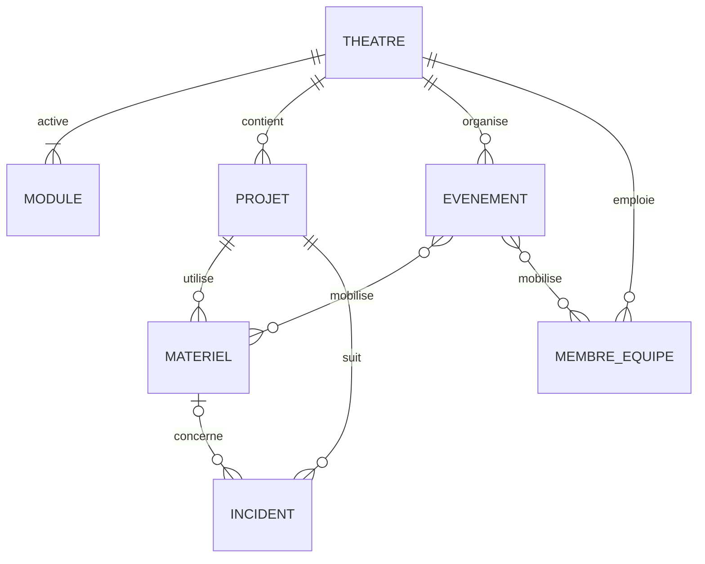

# Schéma des données — StageOps Mobile

Ce document décrit les données que l'application manipule et comment elles sont reliées entre
elles. Comme [ARCHITECTURE.md](../ARCHITECTURE.md), il décrit la version **visée**.

## Comment sont rangées les données

L'application stocke ses données dans **PouchDB** sur le téléphone, synchronisé avec **CouchDB**
sur le serveur. Ces bases n'ont pas de tables comme une base classique : chaque élément (un
projet, un équipement, un incident…) est une **fiche** indépendante, appelée « document ». Les
fiches d'un même type jouent le rôle d'une table.

Les données sont celles du serveur : ce document reprend les champs définis par le backend, avec
leur nom technique entre parenthèses quand il est utile aux développeurs.

### Ce que toutes les fiches ont en commun

| Champ | Description |
|---|---|
| Identifiant (`_id`) | Code unique de la fiche. |
| Version (`_rev`) | Numéro de version géré par CouchDB. Il change à chaque modification et sert à la synchronisation et à la détection des conflits. |
| Type (`type`) | Le type de fiche : projet, matériel, incident… C'est ce qui remplace le nom de la table. |
| Théâtre (`theatre_id`) | Le théâtre auquel appartient la fiche. Un téléphone ne reçoit que les fiches de son théâtre. |

## Vue d'ensemble

À lire ainsi : un théâtre contient des projets ; un projet utilise du matériel et suit des
incidents ; un incident peut concerner un équipement. Les événements dépendent du théâtre, pas
d'un projet, et peuvent mobiliser du matériel et des membres de l'équipe.

## Les types de fiches

### Module

> **À quoi ça sert** : les modules sont les trois métiers du théâtre : lumière, son et plateau.
> Cette fiche indique si un métier est activé pour tout le théâtre. Elle permet à l'application
> de n'afficher que les parties utiles.

| Champ | Description |
|---|---|
| Nom (`name`) | Lumière (`lumiere`), son (`son`) ou plateau (`plateau`). |
| Actif (`active`) | Oui ou non. |
| Dernière modification (`updated_at`) | Date du dernier changement. |

### Projet

> **À quoi ça sert** : un projet représente une production du théâtre (un spectacle, un
> festival…) sur une période donnée. C'est le point d'entrée de l'application : le technicien
> choisit d'abord son projet, puis travaille sur le matériel et les incidents de ce projet.

| Champ | Description |
|---|---|
| Nom (`name`) | Nom du projet, par exemple « Festival StageOps ». |
| Lieu (`venue`) | Salle ou lieu du projet. |
| Date de début / de fin (`start_date`, `end_date`) | Période du projet, au format année-mois-jour. |
| Modules du projet (`modules_config`) | Lumière, son et/ou plateau activés pour ce projet. Un module désactivé reste consultable, mais on ne peut plus rien y créer ni modifier. |
| Création / dernière modification (`created_at`, `updated_at`) | Dates gérées par le serveur. |

### Matériel

> **À quoi ça sert** : chaque fiche matériel décrit un équipement utilisé sur un projet (un
> projecteur, une console, une enceinte…). C'est l'inventaire du technicien : il y consulte
> l'état d'un équipement, le met à jour sur le terrain, et retrouve sa fiche en scannant son QR
> code.

| Champ | Description |
|---|---|
| Projet (`project_id`) | Le projet auquel l'équipement est rattaché. |
| Module (`module`) | Lumière (`lighting`), son (`audio`) ou plateau (`stage`). |
| Nom (`name`) | Nom de l'équipement, par exemple « Lyre face jardin ». Le serveur refuse les noms en double. |
| Type d'appareil (`kind`) | Dépend du module, voir le tableau ci-dessous. |
| État (`status`) | OK (`ok`), à vérifier (`to-check`), hors service (`hs`) ou en réparation (`repair`). |
| QR code (`qr_code`) | Code collé sur l'équipement pour ouvrir sa fiche. Facultatif. |
| Emplacement (`location`) et zone (`zone`) | Où se trouve l'équipement. Facultatifs. |
| Responsable (`responsible_person`) | Personne en charge de l'équipement. Facultatif. |
| Dernière vérification (`last_check`) | Date du dernier contrôle. Facultatif. |
| Adressage DMX (`dmx_universe`, `dmx_address`, `dmx_channels`) | Lumière uniquement : univers, adresse de départ et nombre de canaux. Deux équipements d'un même projet ne peuvent pas occuper les mêmes adresses. |
| Notes (`notes`) | Remarques libres. |
| Création / dernière modification (`created_at`, `updated_at`) | Dates gérées par le serveur. |

Types d'appareils possibles selon le module :

| Module | Types |
|---|---|
| Lumière | Lyre (`moving-head`), projecteur fixe (`fixed`), laser (`laser`), autre (`other`) |
| Son | Micro (`microphone`), micro sans fil (`wireless`), console (`console`), enceinte (`speaker`), autre (`other`) |
| Plateau | Décor (`set`), sécurité (`safety`), accroche (`rigging`), autre (`other`) |

Le serveur stocke aussi une position 3D (`position`) ; elle n'est pas utilisée par l'application
mobile.

### Incident

> **À quoi ça sert** : un incident est un problème signalé sur le terrain (un projecteur qui ne
> répond plus, un câble défectueux…). Il permet de prévenir l'équipe, de suivre le problème
> jusqu'à sa résolution et de garder une trace de ce qui a été fait. C'est la principale donnée
> créée hors ligne par les techniciens.

| Champ | Description |
|---|---|
| Projet (`project_id`) | Le projet concerné. |
| Module (`module`) | Lumière (`lighting`) ou son (`audio`) uniquement. |
| Titre (`title`) | Résumé du problème. |
| Description (`description`) | Détail du problème. |
| Gravité (`severity`) | Faible (`low`), moyenne (`medium`), élevée (`high`) ou critique (`critical`). |
| Statut (`status`) | Ouvert (`open`), en cours (`in-progress`), résolu (`resolved`) ou clos (`closed`). |
| Matériel associé (`equipment_id`) | L'équipement concerné. Facultatif. |
| Signalé par (`reported_by`) | La personne qui a déclaré l'incident. |
| Date de résolution (`resolved_at`) | Quand le problème a été réglé. |
| Notes de résolution (`resolution_notes`) | Ce qui a été fait pour régler le problème. |
| Photos (`images`) | Photos jointes à l'incident. |
| Création / dernière modification (`created_at`, `updated_at`) | Dates gérées par le serveur. |

### Événement

> **À quoi ça sert** : un événement est un moment de la vie du théâtre (une représentation, un
> concert…) avec ses étapes, du montage au démontage. L'application les affiche pour que le
> technicien sache ce qui est prévu, avec quel matériel et quelle équipe.

| Champ | Description |
|---|---|
| Titre (`title`) | Nom de l'événement. |
| Début / fin (`startDate`, `endDate`) | Date et heure de début et de fin. |
| Lieu (`venue`) et scène (`stage`) | Où se déroule l'événement. |
| Statut (`status`) | En préparation (`planning`), montage (`setup`), en cours (`running`), démontage (`strike`) ou terminé (`completed`). |
| Avancement de la checklist (`checklistProgress`) | Où en est la préparation. |
| Matériel (`equipmentIds`) | Les équipements mobilisés. |
| Équipe (`teamMembers`) | Les membres de l'équipe mobilisés. |

### Membre d'équipe

> **À quoi ça sert** : une fiche membre d'équipe décrit une personne de l'équipe technique, pour
> savoir qui fait quoi et qui contacter. Ce n'est **pas** un compte : une personne peut avoir une
> fiche sans pouvoir se connecter à l'application.

| Champ | Description |
|---|---|
| Nom (`name`) | Nom de la personne. |
| Rôle (`role`) | Son poste dans l'équipe. |
| Photo (`avatar`) | Facultative. |
| Email (`email`) et téléphone (`phone`) | Pour la contacter. Le téléphone est facultatif. |
| Permissions (`permissions`) | Liste des droits associés à la fiche. |

## Ce qui ne va jamais sur le téléphone

Les **comptes**, les **sessions de connexion**, la liste des **téléphones autorisés** et
l'**historique de sécurité** restent uniquement sur le serveur. Ils ne sont jamais copiés dans la
base du téléphone.

Le téléphone garde seulement, dans son stockage sécurisé, de quoi rester connecté et son
autorisation hors ligne (voir [ARCHITECTURE.md](../ARCHITECTURE.md#connexion-et-sécurité)).

## À signaler à l'équipe backend

- Les **événements** ne sont rattachés à aucun projet, contrairement au matériel et aux
  incidents.
- Les **événements** n'écrivent pas leurs noms de champs comme les autres fiches (`startDate`
  au lieu de `start_date`) et n'ont pas de dates de création ni de modification.

## Aujourd'hui dans le MVP

Le code actuel utilise une base SQLite, avec de vraies tables. Elles seront remplacées par les
fiches décrites plus haut.

| Table | À quoi elle sert |
|---|---|
| `equipment` | L'inventaire du matériel, sans notion de projet ni de module. |
| `incidents` | Les incidents déclarés, avec des gravités et des statuts différents de ceux du serveur. |
| `outbox_events` | La file d'attente des modifications faites hors ligne, en attente d'envoi au serveur. Avec PouchDB, elle disparaît : la synchronisation s'en charge. |
| `sync_state` | Des informations techniques sur la synchronisation, comme la date de la dernière synchronisation. |
