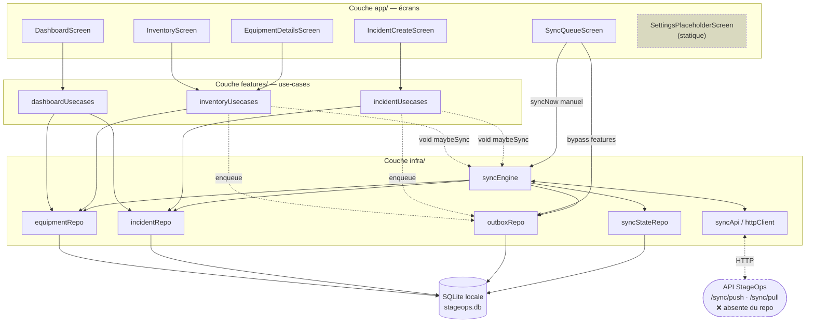

# État d'avancement — StageOps Mobile App

---

## 1. Résumé exécutif

StageOps Mobile est une application **Expo / React Native** destinée aux techniciens de spectacle (son, lumière, vidéo, plateau, sécurité, accroche), conçue pour fonctionner **hors connexion** : toutes les lectures et écritures passent par une base SQLite locale, et les modifications sont mises en file d'attente dans une table `outbox_events` pour être poussées vers une API quand le réseau revient.

**Niveau de maturité global : prototype avancé / MVP technique.** Le socle est solide et cohérent — il compile (`tsc --noEmit` passe sans erreur), il lint proprement, et les 5 écrans sont réellement branchés sur la base locale. Mais il ne s'agit pas encore d'un produit : plusieurs fonctionnalités annoncées manquent, et il n'existe aucun filet de sécurité automatisé.

**Les 3 points clés à retenir :**

1. **La couche offline (SQLite + migrations + outbox + moteur de sync push/pull avec backoff exponentiel) est écrite et cohérente** — c'est la partie la plus aboutie du projet.
2. **La synchronisation ne démarre jamais toute seule** : aucun déclenchement au lancement de l'app, ni au retour du réseau. La promesse « offline-first » n'est donc pas tenue de bout en bout aujourd'hui (voir §4 et §8).
3. **Trois manques structurants** : aucune authentification, aucun scan QR, **zéro test et zéro CI** — alors que la logique la plus risquée (résolution de conflits, file de sync) est précisément celle qui devrait être testée.

---

## 2. Stack technique

| Élément | Version installée | Source |
|---|---|---|
| Expo SDK | **54.0.33** | `apps/mobile/package.json:22`, vérifié dans `node_modules` |
| React Native | **0.81.5** | `apps/mobile/package.json:29` |
| React | **19.1.0** | `apps/mobile/package.json:28` |
| TypeScript | **5.9.3** (`strict: true`) | `apps/mobile/tsconfig.json:4` |
| Base locale | `expo-sqlite` **16.0.10** | `apps/mobile/package.json:26` |
| Navigation | `@react-navigation` **7.x** (native-stack + bottom-tabs) | `apps/mobile/package.json:18-20` |
| Réseau / connectivité | `@react-native-community/netinfo` **11.4.1** | `apps/mobile/package.json:17` |
| Stockage clé/valeur | `@react-native-async-storage/async-storage` **2.2.0** | `apps/mobile/package.json:16` |
| UUID | `expo-crypto` **15.0.8** (`Crypto.randomUUID()`) | `apps/mobile/src/shared/ids.ts:11` |
| Icônes | `@expo/vector-icons` (Ionicons) | `apps/mobile/package.json:15` |
| Lint | ESLint 9 flat config + `eslint-config-expo` + Prettier | `apps/mobile/eslint.config.js` |
| Format | Prettier 3.8.1 | `apps/mobile/.prettierrc` |

**Alias de chemins** configurés en double, côté TypeScript (`tsconfig.json:6-20`) et côté Babel via `babel-plugin-module-resolver` (`babel.config.js:6-19`) : `@/`, `@app/`, `@features/`, `@infra/`, `@shared/`. Les deux configurations sont cohérentes entre elles.

**Infrastructure : aucune.** Pas de `Dockerfile`, pas de `docker-compose`, pas de `eas.json` (build Expo), pas de `.github/`, pas de `.env` ni `.env.example` — vérifié par recherche exhaustive sur l'arborescence.

> ⚠️ **Écart README / réalité** : le `README.md` annonce « React Native **ou** Flutter » et « PouchDB / WatermelonDB » comme technologies *possibles*. Le choix est en réalité déjà tranché et implémenté : React Native (Expo) + `expo-sqlite` brut, sans ORM. Le README n'a pas été mis à jour depuis le commit qui a introduit tout le code.

---

## 3. Architecture

### 3.1 Organisation du code

Le projet suit une **architecture en couches de type Clean Architecture simplifiée**, avec une séparation nette `app` (présentation) / `features` (métier) / `infra` (technique) / `shared` (transverse).

```
StageOps-mobile-app/
├── README.md                     ← désynchronisé du code (voir §8)
├── docs/ETAT_AVANCEMENT.md       ← ce document
└── apps/mobile/                  ← TOUT le code applicatif
    ├── App.tsx                   ← AppProviders > RootNavigator
    ├── index.ts                  ← registerRootComponent
    └── src/
        ├── app/                  ← COUCHE PRÉSENTATION
        │   ├── AppProviders.tsx  ← init DB + migrations + seed, écran de chargement
        │   ├── navigation/       ← RootNavigator (stack), TabNavigator (5 onglets), types
        │   └── screens/          ← 6 écrans
        ├── features/             ← COUCHE MÉTIER (par domaine)
        │   ├── dashboard/        ← usecases + ui
        │   ├── incidents/        ← usecases + ui
        │   ├── inventory/        ← usecases + ui
        │   └── sync/             ← ui uniquement (bandeau de statut)
        ├── infra/                ← COUCHE TECHNIQUE
        │   ├── api/              ← httpClient (fetch + timeout), syncApi (push/pull)
        │   ├── db/               ← db (singleton + helpers), schema, migrations, seed
        │   │   └── repos/        ← equipmentRepo, incidentRepo, outboxRepo, syncStateRepo
        │   ├── logging/          ← log (sink remplaçable)
        │   └── sync/             ← syncEngine, device (device_id), network (hook NetInfo)
        └── shared/               ← constants, ids, types, time (STUB), validation (STUB)
```

**La règle de dépendance est globalement respectée** : `app` → `features` → `infra` → `shared`. Vérifié par lecture des imports. Une exception notable : `SyncQueueScreen.tsx:16-17` importe directement `@infra/db/repos/outboxRepo` et `@infra/sync/syncEngine`, court-circuitant la couche `features` — il n'existe pas de `features/sync/usecases/`, contrairement aux trois autres domaines.

### 3.2 Flux de données



### 3.3 Points d'entrée

1. `apps/mobile/index.ts:5` → `registerRootComponent(App)`
2. `apps/mobile/App.tsx:7-12` → `<AppProviders><RootNavigator/></AppProviders>`
3. `src/app/AppProviders.tsx:22-41` → **bloque le rendu** derrière un `ActivityIndicator` le temps de `openDatabase()` → `migrate()` → `seedIfEmpty()`
4. `src/app/navigation/RootNavigator.tsx` → stack à 2 routes : `Tabs` et `EquipmentDetails`
5. `src/app/navigation/TabNavigator.tsx` → 5 onglets typés

---

## 4. État des fonctionnalités

Légende : ✅ implémenté et fonctionnel · 🟡 partiel / stub / en cours · ❌ prévu mais absent

### 4.1 Socle technique

| Fonctionnalité | Statut | Fichiers principaux | Commentaire |
|---|:---:|---|---|
| Bootstrap application | ✅ | `src/app/AppProviders.tsx` | Ouvre la DB, migre, seed, puis rend l'arbre. Loader pendant l'init. |
| Schéma SQLite | ✅ | `src/infra/db/schema.ts` | 4 tables (`equipment`, `incidents`, `outbox_events`, `sync_state`) + 6 index, tout en `IF NOT EXISTS`. |
| Migrations versionnées | ✅ | `src/infra/db/migrations.ts` | Version stockée dans `sync_state.schema_version`, application idempotente, transaction exclusive (`:45`), gabarit prêt pour V2 (`:83`). |
| Helpers DB | ✅ | `src/infra/db/db.ts` | Singleton, WAL activé (`:22`), `run`/`getAll`/`getFirst`/`transaction`, logs et remontée d'erreur systématiques. |
| Données de démo | ✅ | `src/infra/db/seed.ts` | 8 équipements + 3 incidents réalistes, insérés **uniquement si la table est vide** (`:181`). |
| Logger | ✅ | `src/infra/logging/log.ts` | 4 niveaux, sink remplaçable via `setLogSink` (`:41`) — **jamais appelé** pour l'instant. |
| Identifiant appareil | ✅ | `src/infra/sync/device.ts` | UUID persisté dans AsyncStorage, cache mémoire, tolérant aux échecs de lecture/écriture. |
| Client HTTP | ✅ | `src/infra/api/httpClient.ts` | `AbortController` + timeout 15 s, erreurs typées `HttpError` / `HttpTimeoutError`, gestion du 204. |
| Détection réseau | ✅ | `src/infra/sync/network.ts` | Hook `useNetworkStatus()` sur NetInfo, fetch initial + abonnement. |

### 4.2 Écrans et parcours utilisateur

| Fonctionnalité | Statut | Fichiers principaux | Commentaire |
|---|:---:|---|---|
| Navigation (stack + 5 onglets) | ✅ | `src/app/navigation/*` | Typage complet des params (`types.ts`), augmentation globale de `ReactNavigation.RootParamList` (`:36-41`). |
| Tableau de bord | ✅ | `src/app/screens/DashboardScreen.tsx`, `features/dashboard/*` | 4 compteurs (HS / à vérifier / opérationnels / incidents ouverts) + 3 incidents des dernières 24 h. Rechargement à chaque focus (`:104`), états loading et erreur gérés. |
| Inventaire + recherche + filtres | ✅ | `src/app/screens/InventoryScreen.tsx`, `features/inventory/ui/*` | Filtrage **côté SQL** (`equipmentRepo.ts:29-53`) sur texte, statut et catégorie. Chips horizontaux, état vide géré. |
| Détail équipement | ✅ | `src/app/screens/EquipmentDetailsScreen.tsx` | Fiche complète, modal de changement de statut, barre d'actions. États loading / introuvable gérés (`:250-265`). |
| Changement de statut équipement | ✅ | `features/inventory/usecases/inventoryUsecases.ts:74-108` | Écrit en local **puis** empile un `EQUIPMENT_UPDATE_STATUS` dans l'outbox, puis tente une sync opportuniste. Chaîne complète et correcte. |
| Déclaration d'incident | ✅ | `src/app/screens/IncidentCreateScreen.tsx`, `features/incidents/*` | Formulaire titre / sévérité / description / équipement, insertion locale + événement `INCIDENT_CREATE`. |
| File de synchronisation (UI) | ✅ | `src/app/screens/SyncQueueScreen.tsx` | Liste tous les événements avec statut, âge, nb d'essais, dernière erreur ; compteurs ; bouton « Réessayer » ; remise en attente d'un événement échoué. |
| Bandeau de statut sync | 🟡 | `features/sync/ui/SyncStatusBanner.tsx` | Affiche en ligne / hors ligne + dernière sync relative. Mais il **ne reflète pas la sync en cours** (n'utilise pas `isSyncing()`) ni le nombre d'éléments en attente, et ne relit `last_sync_at` qu'au montage et au changement de connectivité (`:33`). |
| Préremplissage équipement depuis la fiche | 🟡 | `EquipmentDetailsScreen.tsx:242-247`, `IncidentForm.tsx:57` | La navigation passe bien `equipmentId`, mais `IncidentForm` ne lit cette valeur que **dans l'état initial** (`useState(initialEquipmentId ?? '')`). L'onglet restant monté, le préremplissage ne fonctionne qu'au tout premier affichage. Bug confirmé par lecture du code. |
| Écran Réglages | 🟡 | `src/app/screens/SettingsPlaceholderScreen.tsx` | Purement statique et non interactif. L'URL d'API y est **écrite en dur** : `https://api.stageops.app` (`:16`), en contradiction avec la valeur réelle utilisée par le code (`http://localhost:8080`, `shared/constants.ts:10`). |
| Scan QR Code | ❌ | — | Le bouton « Scanner QR » du tableau de bord (`DashboardScreen.tsx:162`) est un `TouchableOpacity` **sans `onPress`** : il ne fait rien. Aucune dépendance `expo-camera` / `expo-barcode-scanner`, aucun écran de scan. Le champ `qr_code` existe en base mais n'est utilisé qu'en affichage (`EquipmentDetailsScreen.tsx:292`). |
| Authentification utilisateur | ❌ | — | Annoncée au README. **Aucune trace dans le code** : pas d'écran de login, pas de notion d'utilisateur, pas de token, aucun header `Authorization` dans `httpClient.ts`. Le champ `created_by` d'un incident est rempli avec le `device_id` (`incidentUsecases.ts:48`), pas avec une identité. |
| « Visualisation technique simplifiée » | ❌ | — | Mentionnée au README, aucun code correspondant (pas de plan de scène, de patch, ni de schéma). |

### 4.3 Moteur de synchronisation

| Fonctionnalité | Statut | Fichiers principaux | Commentaire |
|---|:---:|---|---|
| Cycle push → pull → apply | ✅ | `src/infra/sync/syncEngine.ts:105-149` | Séquence complète et lisible : envoi d'un lot, traitement des acks un par un, pull depuis le curseur, application des deltas, persistance du curseur et de `last_sync_at`. |
| File d'attente (outbox) | ✅ | `src/infra/db/repos/outboxRepo.ts` | `enqueue` / `markSent` / `markFailed` / `resetEvent`, plafond d'essais (`SYNC_MAX_EVENT_ATTEMPTS = 5`), passage automatique en `FAILED` (`:84-87`). |
| Backoff exponentiel | ✅ | `syncEngine.ts:35-63` | *Full jitter*, base 2 s, plafond 5 min (`shared/constants.ts:26-29`), timer annulable. |
| Verrou anti-concurrence | ✅ | `syncEngine.ts:164-167` | Drapeau `_running`, une seule sync à la fois. |
| Résolution de conflits | 🟡 | `equipmentRepo.ts:89`, `incidentRepo.ts:87` | Stratégie **« last write wins »** uniquement, via `WHERE excluded.updated_at >= table.updated_at` dans le `ON CONFLICT DO UPDATE`. C'est fonctionnel et volontaire, mais le README parle de « résolution de conflits » sans préciser : il n'y a **aucune fusion, aucune détection ni signalement de conflit** à l'utilisateur. |
| Suppressions synchronisées | 🟡 | `syncEngine.ts:81-85` | L'opération `op: 'delete'` est explicitement **non traitée** (simple `log.warn`). Le code suppose que le serveur envoie les suppressions sous forme d'upsert avec `deleted_at` renseigné — hypothèse non vérifiable sans le backend. Les fonctions `softDeleteEquipment` / `softDeleteIncident` existent mais ne sont appelées nulle part. |
| **Déclenchement automatique** | 🟡 | `grep` exhaustif de `maybeSync` / `syncNow` | **Point critique.** La sync n'est déclenchée que dans 3 cas : (a) après une écriture locale (`inventoryUsecases.ts:105`, `incidentUsecases.ts:80`) ; (b) par le timer de retry après un échec (`syncEngine.ts:56`) ; (c) par le bouton manuel de `SyncQueueScreen`. **Il n'y a ni sync au démarrage de l'app, ni sync au retour du réseau, ni sync périodique, ni tâche de fond.** Concrètement : un technicien qui saisit des incidents hors ligne et retrouve le réseau sans rien faire ne verra rien partir tant qu'il n'ouvrira pas l'onglet Sync pour appuyer sur « Réessayer ». |
| Types d'événements `*_UPDATE` | 🟡 | `shared/types.ts:50-54` | `EQUIPMENT_UPDATE` et `INCIDENT_UPDATE` sont déclarés dans le type et libellés dans l'UI (`SyncQueueScreen.tsx:32-34`), mais **jamais produits** : aucun code n'appelle `enqueue` avec ces types. |
| Backend / API StageOps | ❌ | — | Absent du dépôt. Le contrat (`/sync/push`, `/sync/pull`, formes `SyncPushRequest` / `SyncPullResponse`) est défini côté client dans `shared/types.ts:81-116` et `infra/api/syncApi.ts`, mais **n'a pu être confronté à aucun serveur**. Je ne peux donc pas affirmer que la synchronisation fonctionne réellement de bout en bout — seulement que le code client est cohérent avec son propre contrat. |

### 4.4 Utilitaires transverses

| Fonctionnalité | Statut | Fichiers principaux | Commentaire |
|---|:---:|---|---|
| `shared/time.ts` | 🟡 | `src/shared/time.ts:1` | Fichier d'une ligne : `// TODO: implement src/shared/time.ts`. Conséquence directe : la logique de formatage temporel est **dupliquée trois fois** — `formatTime` (`DashboardScreen.tsx:40`), `formatRelative` (`SyncStatusBanner.tsx:10`), `formatAge` (`SyncQueueScreen.tsx:41`). |
| `shared/validation.ts` | 🟡 | `src/shared/validation.ts:1` | Idem, stub `// TODO`. La seule validation existante est inline et minimale : `form.title.trim().length > 0` (`IncidentForm.tsx:62`). Les données entrantes du serveur sont castées sans contrôle (`syncEngine.ts:78` : `change.data as unknown as Equipment`). |

---

## 5. Modèle de données et intégrations externes

### 5.1 Schéma local (SQLite — `stageops.db`, schéma V1)

Défini dans `src/infra/db/schema.ts`. Conventions respectées partout : **timestamps en INTEGER epoch ms**, **suppression logique via `deleted_at`**.

**`equipment`** (`schema.ts:16-30`) — `id` TEXT PK, `name`, `category`, `qr_code` (UNIQUE), `location`, `status` (défaut `'OK'`), `responsible_name`, `last_check_at`, `notes`, `updated_at`, `deleted_at`.

**`incidents`** (`schema.ts:32-45`) — `id` TEXT PK, `equipment_id`, `title`, `severity` (défaut `'FAIBLE'`), `status` (défaut `'OPEN'`), `description`, `created_by`, `created_at`, `updated_at`, `deleted_at`.

**`outbox_events`** (`schema.ts:47-58`) — `event_id` TEXT PK, `device_id`, `type`, `payload_json`, `created_at`, `status` (défaut `'PENDING'`), `last_error`, `attempt_count`.

**`sync_state`** (`schema.ts:60-66`) — table clé/valeur : `schema_version`, `cursor`, `last_sync_at`.

**Index** (`schema.ts:72-79`) : sur `equipment(status)`, `equipment(category)`, `equipment(updated_at)`, `incidents(status)`, `incidents(equipment_id)`, `outbox_events(status, created_at)`.

> **Remarques sur le schéma.** (1) Il n'y a **aucune contrainte de clé étrangère** : `incidents.equipment_id` n'est pas déclaré `REFERENCES equipment(id)`, et `PRAGMA foreign_keys` n'est jamais activé. Rien n'empêche donc un incident de pointer vers un équipement inexistant — d'autant que `IncidentForm.tsx:78-87` laisse l'utilisateur **saisir l'ID à la main** en texte libre. (2) Les énumérations (`category`, `status`, `severity`) sont typées en TypeScript (`shared/types.ts`) mais **non contraintes en base** (pas de `CHECK`). (3) Aucune table `users` — cohérent avec l'absence d'authentification.

### 5.2 Types métier

`src/shared/types.ts` est la source de vérité unique et bien tenue (117 lignes) : entités (`Equipment`, `Incident`, `OutboxEvent`, `SyncState`), énumérations (`EquipmentCategory`, `EquipmentStatus`, `IncidentSeverity`, `IncidentStatus`, `OutboxEventType`, `OutboxStatus`) et **contrats d'API** (`SyncPushRequest`, `SyncPushResponse`, `SyncPushAck`, `SyncPullResponse`, `SyncChange`).

### 5.3 Intégrations externes

| Intégration | Statut | Détail |
|---|:---:|---|
| API StageOps | 🟡 (client seul) | `POST /sync/push` et `GET /sync/pull?cursor=...` (`infra/api/syncApi.ts`). URL de base : `process.env.EXPO_PUBLIC_API_URL`, **défaut `http://localhost:8080`** (`shared/constants.ts:9-10`). Aucun `.env.example` ne documente cette variable. Le serveur n'est pas dans ce dépôt. |
| Stockage appareil | ✅ | AsyncStorage, une seule clé : `device_id` (`infra/sync/device.ts:6`). |
| Crypto | ✅ | `expo-crypto` pour les UUID v4. |
| Télémétrie / crash reporting | ❌ | Aucun Sentry ni équivalent. Le logger prévoit le branchement (`log.ts:3`, `setLogSink`) mais rien n'est câblé. |
| Notifications push | ❌ | Aucune dépendance, aucun code. |
| `expo-font` | ⚠️ | Déclaré comme plugin dans `app.json:38` et comme dépendance, mais **aucune police n'est chargée** dans le code (`useFonts` / `loadAsync` absents). Dépendance inutile en l'état. |

---

## 6. Qualité et outillage

### 6.1 Vérifications que j'ai réellement exécutées

| Commande | Résultat |
|---|---|
| `npx tsc --noEmit` | ✅ **Passe, 0 erreur.** Le projet est en mode `strict`. |
| `npm run lint` (`--max-warnings=0`) | ✅ **Passe, 0 warning.** |
| `npx prettier --check 'src/**/*.{ts,tsx,json}'` | ❌ **Échoue : 33 fichiers sur 37 non formatés.** Le script `format` existe (`package.json:11`) mais n'a manifestement jamais été exécuté. |
| `npm audit` | ⚠️ **35 vulnérabilités** : 2 critiques, 19 hautes, 13 modérées, 1 basse. |
| `npm outdated` | ⚠️ 24 paquets en retard sur `latest` (voir §8). |

### 6.2 Tests

**❌ Absents — totalement.** Aucun fichier `*.test.ts(x)` ou `*.spec.ts(x)`, aucun dossier `__tests__`, aucune configuration Jest, aucune dépendance de test (`jest`, `@testing-library/react-native`, `detox`, `maestro`…), aucun script `test` dans `package.json`. **Couverture : 0 %.**

C'est le point le plus préoccupant du projet, car la logique la plus délicate est aussi la plus facile à tester unitairement sans émulateur : `backoffMs()`, le traitement des acks, `markFailed` et son passage en `FAILED`, la règle « last write wins » des upserts, la construction des filtres SQL.

### 6.3 CI / CD

**❌ Absents.** Pas de `.github/workflows/`, pas de `.gitlab-ci.yml`, pas de fichier CI d'aucune sorte (recherche exhaustive sur toute l'arborescence). Pas non plus de `eas.json` : **aucun build de distribution n'est configuré**, l'app ne peut donc être lancée qu'en développement via Expo Go ou un build local.

### 6.4 Gestion des erreurs

Globalement **soignée pour un prototype**, avec quelques trous identifiés :

- ✅ Toutes les fonctions DB loguent et relaient l'erreur (`db.ts:54-57`, `:71-74`, `:88-91`).
- ✅ Les transactions font un rollback et loguent (`db.ts:119-122`).
- ✅ `applyDeltas` isole chaque ligne dans son propre `try/catch` : une donnée serveur corrompue n'annule pas tout le lot (`syncEngine.ts:86-89`).
- ✅ Les écrans gèrent les états loading / erreur / vide (dashboard, inventaire, détail, file de sync).
- 🟡 `AppProviders.tsx:31-34` : si l'initialisation de la base échoue, l'erreur est loguée et **l'app reste bloquée indéfiniment sur le spinner**. Le commentaire du code l'assume : *« In a real app: surface an error screen here »*.
- 🟡 `SyncQueueScreen.tsx:250-259` : `handleSyncNow` appelle `syncNow()` (et non `maybeSync()`), dans un `try/finally` **sans `catch`**. Hors ligne ou en cas d'erreur serveur, la promesse est rejetée sans être traitée → *unhandled promise rejection*, et aucun message n'est affiché à l'utilisateur.
- 🟡 `InventoryScreen.tsx:31` : `.catch(() => setItems([]))` avale silencieusement l'erreur et affiche « Aucun équipement trouvé » — indiscernable d'un résultat légitimement vide.

### 6.5 Observabilité

🟡 Un logger maison (`infra/logging/log.ts`) avec 4 niveaux, préfixe `[NIVEAU][Tag]` et sink remplaçable. Il est utilisé de façon **cohérente et disciplinée** dans toute la couche `infra`. En revanche le sink par défaut (console) n'est jamais remplacé, il n'y a **aucun filtrage par niveau** (les logs `debug` — dont chaque requête SQL avec ses paramètres — partent en production), et aucun export vers un service externe.

### 6.6 Sécurité

| Point | Constat |
|---|---|
| Secrets en dur | ✅ **Aucun** trouvé. Pas de clé d'API, pas de token, pas de mot de passe dans le code. |
| Authentification | ❌ **Inexistante.** `httpClient.ts:59-63` n'envoie que `Content-Type` et `Accept`. Le serveur ne reçoit qu'un `device_id` non vérifiable (`syncApi.ts:25`) : n'importe qui peut pousser des événements en se prétendant un appareil arbitraire. |
| Injection SQL | ✅ **Correctement prévenue.** Toutes les requêtes sont paramétrées (`?`). Le seul endroit où du SQL est construit dynamiquement (`equipmentRepo.ts:32-52`) n'interpole que des noms de conditions figés définis dans le code, jamais une valeur utilisateur. |
| Validation des entrées | 🟡 Très faible. Côté formulaire : titre non vide uniquement. Côté serveur : **aucune** — les payloads de `/sync/pull` sont castés directement en entités (`syncEngine.ts:78, :80`). `shared/validation.ts` est resté un stub. |
| Transport | ⚠️ L'URL par défaut est en **HTTP en clair** (`http://localhost:8080`). Acceptable en développement ; rien dans le code n'impose HTTPS en production. |
| Données au repos | ⚠️ La base SQLite n'est pas chiffrée (pas de SQLCipher). À évaluer selon la sensibilité réelle des données de production. |
| Vulnérabilités de dépendances | ⚠️ 2 critiques (`shell-quote`, `tar`) et 19 hautes. **Toutes sont transitives et concentrées dans la chaîne de build Expo/Metro** (`@expo/cli`, `metro`, `undici`, `ws`, `node-forge`…), pas dans le code embarqué dans l'application. Le risque réel est donc limité au poste de développement et à la CI, mais il doit être traité. |

---

## 7. Activité récente

L'historique tient en **4 commits**, sur la seule branche `main` (aucune autre branche locale ou distante, aucun tag). Remote : `git@github.com:StageOps-EIP/StageOps-mobile-app.git`. L'arbre de travail est propre.

| Commit | Date | Auteur | Contenu |
|---|---|---|---|
| `f367119` | 11/02/2026 | Mathieu Simon | Initial commit (README d'une ligne) |
| `1f61a45` | 11/02/2026 | Mathieu Simon | README : description et instructions d'installation (+72 lignes) |
| `e245764` | 11/02/2026 | Mathieu Simon | README : clarification (−41 / +35 lignes) |
| `21ff61a` | **06/03/2026** | h `<quentin.fuchs@epitech.eu>` | **« mobile + archi » — 54 fichiers, +16 650 lignes** |

**Lecture de cet historique :**

- Le projet a vécu **trois semaines en README seul** (février), puis **tout le code est arrivé d'un bloc en un unique commit** le 6 mars 2026. Il n'y a donc aucune granularité exploitable : impossible de reconstituer l'ordre de construction, de retrouver une décision ou d'isoler une régression via `git bisect`.
- **Aucun commit depuis le 6 mars 2026**, soit un peu plus de six mois d'inactivité à la date de cet audit. Aucun travail n'est visiblement en cours.
- Deux contributeurs distincts, avec une rupture nette : l'un a écrit la documentation, l'autre tout le code. Le README n'a jamais été repris après l'arrivée du code, ce qui explique les écarts relevés en §2 et §8.
- **Note :** ces dates proviennent des métadonnées Git et sont donc celles déclarées par les machines des auteurs.

---

## 8. Dette technique et risques

### 🔴 Priorité haute

1. **La synchronisation automatique n'existe pas** — `syncEngine.ts`, aucun appelant au démarrage ni sur événement réseau.
   C'est la promesse centrale du produit (« synchronisation automatique », README) et elle n'est pas tenue. L'infrastructure est là (`useNetworkStatus`, `maybeSync` avec garde hors ligne intégrée), il manque le câblage : un appel au montage de l'app et un abonnement `NetInfo.addEventListener` déclenchant `maybeSync()` au retour de la connectivité.

2. **Aucune authentification** — absente du code, annoncée au README.
   Au-delà de la fonctionnalité manquante, c'est un risque de sécurité : l'endpoint `/sync/push` n'est protégé par rien d'autre qu'un `device_id` déclaratif, et `created_by` n'identifie personne. Impacte la traçabilité des incidents, ce qui est problématique sur du matériel de sécurité (harnais, moteurs d'accroche).

3. **Zéro test, zéro CI** — aucun garde-fou.
   La logique de sync et de résolution de conflits est modifiable sans aucun filet. Un projet à deux contributeurs, sans CI et avec un historique d'un seul gros commit, n'a aucun moyen de détecter une régression.

4. **Le backend n'existe pas dans ce périmètre** — contrat client défini mais non confronté.
   **Je ne peux pas affirmer que la synchronisation fonctionne.** Le code client est cohérent avec lui-même ; il n'a jamais pu être validé contre un vrai serveur. Tant que ce n'est pas fait, tout le moteur de sync reste théorique. En particulier, la sémantique du `cursor` (opaque ? timestamp ?) et la convention de suppression (upsert avec `deleted_at` vs `op: 'delete'`, non géré — `syncEngine.ts:81-85`) sont des hypothèses non vérifiées.

### 🟠 Priorité moyenne

5. **Croissance illimitée de la table `outbox_events`** — `outboxRepo.ts`.
   Aucune purge des événements `SENT`. Ils s'accumulent indéfiniment, alourdissent `getAllEvents()` (`:31`) qui alimente la liste de l'écran Sync, et donc la mémoire de l'app sur la durée.

6. **`markSent` incrémente `attempt_count`** — `outboxRepo.ts:65`.
   Un événement réussi du premier coup s'affiche « 1 essai » dans l'UI (`SyncQueueScreen.tsx:89`). Sémantiquement discutable : un compteur d'essais devrait compter les échecs, ou être incrémenté avant la tentative, pas après un succès.

7. **Préremplissage de l'équipement cassé après le premier affichage** — `IncidentForm.tsx:57`.
   `useState(initialEquipmentId ?? '')` ne réagit pas aux changements de prop, et l'écran est un onglet qui reste monté. Le parcours « fiche équipement → Signaler incident » ne préremplit donc qu'une seule fois par session.

8. **Le formulaire d'incident n'est pas réinitialisé après envoi** — `IncidentForm.tsx:56`.
   L'écran étant un onglet persistant, le titre et la description saisis restent affichés après une création réussie. Risque concret de doublon si l'utilisateur revient sur l'onglet et réappuie sur « Enregistrer ».

9. **`syncNow()` sans `catch` dans l'UI** — `SyncQueueScreen.tsx:250-259`.
   Rejet de promesse non traité, et aucun retour d'erreur à l'utilisateur en cas d'échec du bouton « Réessayer ».

10. **Saisie de l'ID d'équipement en texte libre** — `IncidentForm.tsx:78-87`.
    Demander à un technicien de taper `equip-004` sur un plateau est irréaliste, et rien ne vérifie que l'ID existe (pas de FK, pas de validation). C'est exactement le trou que le scan QR devait combler.

11. **33 fichiers sur 37 non formatés** — `prettier --check` échoue.
    Le formatage n'a jamais été appliqué. Tout futur `npm run format` produira un diff massif qui noiera les vraies modifications. À corriger une bonne fois, idéalement avec un hook de pre-commit.

12. **Vulnérabilités de dépendances** — 2 critiques, 19 hautes.
    Transitives et cantonnées à la chaîne de build Expo/Metro, donc sans impact sur le binaire livré, mais à traiter (`npm audit fix`, puis montée de version d'Expo).

13. **Absence d'outillage monorepo** — la racine ne contient que `README.md` et `apps/`.
    La structure `apps/mobile` annonce un monorepo (le README mentionne une « API StageOps » séparée) mais il n'y a ni `package.json` racine, ni workspaces npm/pnpm, ni Turborepo. Toute commande doit être lancée depuis `apps/mobile`, ce qui n'est écrit nulle part.

14. **`shared/time.ts` et `shared/validation.ts` restés à l'état de `TODO`** — conséquence directe : trois implémentations divergentes du formatage temporel, et aucune validation centralisée des données entrantes.

### 🟡 Priorité basse

15. **Le README décrit un autre projet que celui qui existe** — arborescence annoncée (`src/screens/`, `src/modules/equipment|incidents|scan`, `src/services/`, `src/storage/`, `src/sync-engine/`) contre arborescence réelle (`src/app|features|infra|shared`). Stack annoncée comme un choix ouvert (« React Native ou Flutter », « PouchDB ou WatermelonDB ») alors qu'elle est tranchée. Fonctionnalités listées comme acquises alors que deux sont absentes. Pour quelqu'un qui découvre le projet, le README est aujourd'hui trompeur.

16. **Incohérence de thème** — l'application est sombre (`#0f172a`) sur tous les écrans principaux, mais `SyncStatusBanner.tsx:74-83` utilise des fonds clairs (`#fef3c7`, `#f0fdf4`) et `SettingsPlaceholderScreen.tsx:33` un fond clair complet. Aucun système de design centralisé : les couleurs sont répétées en dur dans chaque `StyleSheet`.

17. **URL d'API en dur dans les Réglages** — `SettingsPlaceholderScreen.tsx:16` affiche `https://api.stageops.app`, valeur qui ne correspond à rien dans le code. Information fausse présentée à l'utilisateur.

18. **Code écrit mais jamais appelé** — `softDeleteEquipment` / `softDeleteIncident`, `getIncidentById`, `resetDb`, `resetDeviceId`, `setLogSink`, `getSyncValue` / `setSyncValue` en accès direct, et les types d'événements `EQUIPMENT_UPDATE` / `INCIDENT_UPDATE`. Ce n'est pas du code mort au sens strict (API de couche basse, raisonnablement anticipée), mais l'écart entre surface exposée et surface utilisée est notable.

19. **`expo-font` déclaré et inutilisé** — plugin dans `app.json:38` et dépendance, sans aucun chargement de police.

20. **Dépendances en retard** — 24 paquets. Les plus notables : Expo 54 → 57, React Native 0.81 → 0.87, `@react-navigation` 7.1/7.15 → 7.19 (mineur, sans risque), `@react-native-community/netinfo` 11 → 12, `async-storage` 2 → 3 (majeurs, avec ruptures potentielles). Rien d'alarmant : l'ensemble est cohérent avec le SDK Expo 54.

21. **Pas d'internationalisation ni d'accessibilité** — tous les libellés sont des chaînes françaises en dur, aucun `accessibilityLabel` sur les contrôles.

---

## 9. Recommandations et prochaines étapes

Classées par rapport valeur / effort, en commençant par ce qui débloque le reste.

### Étape 1 — Rendre la promesse offline-first réellement vraie (quelques heures)

1. **Déclencher la sync au démarrage et au retour du réseau.** Dans `AppProviders.tsx`, après `seedIfEmpty()`, appeler `void maybeSync()` ; et ajouter un `NetInfo.addEventListener` qui appelle `maybeSync()` lorsque l'état passe de hors ligne à en ligne. `maybeSync()` contient déjà sa propre garde hors ligne et son verrou anti-concurrence (`syncEngine.ts:163-186`) : c'est un branchement, pas une réécriture. **C'est le correctif au meilleur rapport valeur/effort de toute cette liste.**
2. **Corriger les trois bugs d'écran identifiés** : réinitialiser `IncidentForm` après une création réussie, synchroniser `equipmentId` avec la prop via un `useEffect`, et entourer `syncNow()` d'un `catch` dans `SyncQueueScreen` avec un message d'erreur visible.
3. **Afficher un écran d'erreur si l'init de la base échoue**, plutôt que de laisser l'app bloquée sur son spinner.

### Étape 2 — Poser le filet de sécurité (1 à 2 jours)

4. **Installer Jest + `@testing-library/react-native`** et couvrir en priorité, sans émulateur : `backoffMs()`, le traitement des acks de `syncNow()`, la bascule `PENDING → FAILED` de `markFailed`, la règle « last write wins » des upserts, et la construction du SQL de `listEquipment()`.
5. **Ajouter une CI GitHub Actions** exécutant `typecheck`, `lint`, `format:check` et `test` sur chaque push et chaque PR. Le dépôt est déjà sur GitHub, c'est un fichier à écrire.
6. **Appliquer Prettier une fois sur tout le code** (`npm run format`) dans un commit isolé et clairement identifié comme tel, avant que la CI ne rende `format:check` bloquant.

### Étape 3 — Valider le contrat avec le backend (dépend d'une équipe tierce)

7. **Confronter le client à un vrai serveur**, même bouchonné (un petit mock `/sync/push` + `/sync/pull` suffirait pour commencer). Tant que ce n'est pas fait, le moteur de sync reste non validé.
8. **Fixer et documenter le contrat** : sémantique du curseur, convention de suppression (trancher entre `op: 'delete'` et l'upsert avec `deleted_at` — le code ne gère aujourd'hui que le second), et comportement attendu en cas d'ack partiel.
9. **Créer un `.env.example`** documentant `EXPO_PUBLIC_API_URL`, et faire lire cette valeur par l'écran Réglages au lieu de l'URL en dur.

### Étape 4 — Combler les fonctionnalités manquantes (par ordre de valeur terrain)

10. **Scan QR** (`expo-camera`) : c'est la fonctionnalité qui a le plus de valeur d'usage réelle sur un plateau, et elle règle au passage le problème de la saisie manuelle de l'ID d'équipement. Le champ `qr_code` existe déjà en base avec une contrainte d'unicité, et le bouton est déjà là dans l'UI — il n'attend qu'un `onPress`.
11. **Authentification** : écran de login, stockage sécurisé du token (`expo-secure-store` plutôt qu'AsyncStorage), header `Authorization` dans `httpClient`, et remplacement du `device_id` par une véritable identité dans `created_by`. Prérequis : que le backend expose de quoi s'authentifier.

### Étape 5 — Entretien

12. **Purger les événements `SENT`** de l'outbox au-delà d'un certain âge ou d'un certain nombre.
13. **Implémenter `shared/time.ts`** et y rapatrier les trois fonctions de formatage dupliquées ; implémenter `shared/validation.ts` et valider les payloads entrants de `/sync/pull` avant de les caster.
14. **Extraire un thème** (couleurs, espacements, typographies) dans `shared/`, et uniformiser `SyncStatusBanner` et l'écran Réglages sur le thème sombre.
15. **Réécrire le README** pour qu'il décrive le projet tel qu'il est, et y pointer ce document.
16. **Traiter les vulnérabilités** (`npm audit fix`) et planifier la montée vers un SDK Expo plus récent.
17. **Adopter des commits plus fins.** Un commit de 16 650 lignes rend la revue impossible et `git bisect` inutile.

---

## 10. Comment lancer le projet

> ⚠️ **Attention : les instructions du `README.md` sont fausses.** Il indique `cd stageops-mobile-app && npm install`, alors que le `package.json` se trouve dans `apps/mobile/`. Il n'y a **aucun `package.json` à la racine**. La procédure ci-dessous est celle que j'ai déduite des fichiers de configuration.

### Prérequis

- **Node.js** — version non spécifiée dans le projet (pas de champ `engines`, pas de `.nvmrc`). Expo SDK 54 requiert en pratique Node 18 ou plus.
- **npm** (un `package-lock.json` est versionné, pas de `yarn.lock` ni `pnpm-lock.yaml`).
- Pour tester sur appareil : l'application **Expo Go**. Pour l'émulateur : Android Studio ou Xcode.

### Installation

```bash
git clone git@github.com:StageOps-EIP/StageOps-mobile-app.git
cd StageOps-mobile-app/apps/mobile     # ← le sous-dossier, pas la racine
npm install
```

### Configuration

Optionnelle en l'état. L'URL de l'API se règle par la variable d'environnement `EXPO_PUBLIC_API_URL` (`src/shared/constants.ts:9-10`) ; sans elle, l'app utilise `http://localhost:8080`.

```bash
# apps/mobile/.env  — à créer, aucun .env.example n'est fourni
EXPO_PUBLIC_API_URL=http://<ip-du-serveur>:8080
```

> Le fichier `.gitignore:34` n'ignore que `.env*.local` — un `.env` simple **serait donc versionné par erreur**. À corriger avant d'y mettre quoi que ce soit de sensible.

### Lancement

```bash
npm start          # serveur Expo + QR code
npm run android    # émulateur / appareil Android
npm run ios        # simulateur iOS (macOS uniquement)
npm run web        # navigateur
```

**L'application est utilisable immédiatement sans backend.** Au premier lancement, `AppProviders` crée la base, applique la migration V1 et injecte automatiquement 8 équipements et 3 incidents de démonstration (`src/infra/db/seed.ts`). Le tableau de bord, l'inventaire, les filtres, la fiche équipement, le changement de statut et la création d'incident fonctionnent donc entièrement hors ligne.

**Ce qui ne fonctionnera pas sans serveur :** toute tentative de synchronisation échouera. Les événements resteront en `PENDING` puis basculeront en `FAILED` après 5 essais (`shared/constants.ts:23`) — comportement attendu et visible dans l'onglet Sync.

### Vérifications de qualité

```bash
npm run typecheck      # ✅ passe (vérifié)
npm run lint           # ✅ passe (vérifié)
npm run format:check   # ❌ échoue actuellement : 33 fichiers non formatés
npm run format         # applique Prettier (attention : diff massif)
# npm test             # ❌ n'existe pas — aucun test dans le projet
```

### Points qui semblent manquer ou ne pas fonctionner

| Point | Constat |
|---|---|
| Instructions du README | Fausses : mauvais répertoire, pas de mention du sous-dossier `apps/mobile`. |
| `.env.example` | Absent — la seule variable d'environnement du projet n'est documentée nulle part. |
| Version de Node | Non contrainte : ni `engines`, ni `.nvmrc`. |
| Build de distribution | Impossible en l'état : pas de `eas.json`, pas de configuration EAS Build. |
| Script de test | Absent du `package.json`. |
| Backend | Non fourni. Aucun moyen de tester la synchronisation de bout en bout depuis ce seul dépôt. |

---

## Annexe — Méthode et limites de cet audit

**Ce qui a été fait :** lecture intégrale des 37 fichiers source (4 199 lignes) et de tous les fichiers de configuration ; exécution réelle de `tsc --noEmit`, `npm run lint`, `prettier --check`, `npm audit` et `npm outdated` ; traçage par recherche exhaustive des appelants de `maybeSync` / `syncNow` ; analyse de `git log`, des branches et du remote ; recherche des marqueurs `TODO` / `FIXME` / `HACK` / `XXX` sur tout le code (2 occurrences, toutes deux dans `shared/`).

**Ce qui n'a pas pu être fait, et les limites qui en découlent :**

- **L'application n'a jamais été exécutée.** Aucun lancement sur simulateur ou appareil. Les conclusions sur le comportement des écrans reposent sur la lecture du code, pas sur une observation. Un écran peut compiler, linter et sembler correct tout en se comportant mal à l'exécution.
- **Le backend est absent.** Toute la partie synchronisation réseau est évaluée sur la seule cohérence interne du client. **Rien ne permet d'affirmer que la sync fonctionne réellement.**
- **Les bugs signalés en §8 (points 7, 8, 9) sont déduits de la lecture du code**, avec un raisonnement explicité dans chaque cas, mais **non reproduits à l'exécution**. Je les qualifierais de très probables, pas de certains.
- Les dates de l'historique Git proviennent des métadonnées déclarées par les machines des auteurs.

---

*Document généré le 24 septembre 2026 — état du dépôt : branche `main`, commit `21ff61a`, arbre de travail propre.*
